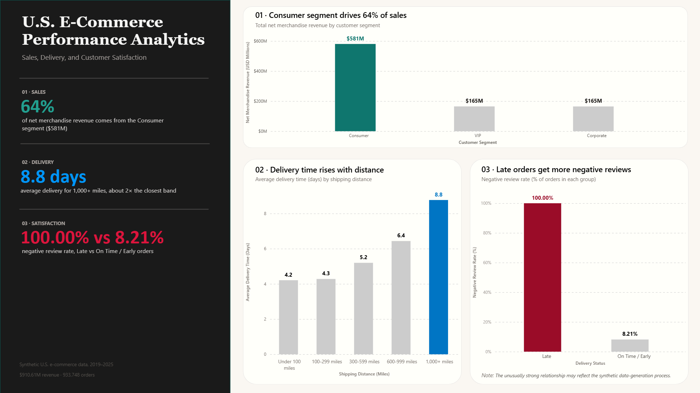

# U.S. E-Commerce Performance Analytics

## Project Overview

This project analyzes a synthetic U.S. e-commerce dataset containing approximately 1 million orders from 2019 to 2025.

The project focuses on three main business areas:

- **Sales**
- **Delivery**
- **Customer Satisfaction**

The project also includes a machine learning component to investigate whether late deliveries can be predicted immediately after payment confirmation using only the information available at that time.

## Business Questions

### Sales
- Are there significant differences in merchandise profitability across customer segments?
- Which customer segment generates the most revenue?

### Delivery
- How are shipping distance and delivery time related?
- Can late deliveries be predicted immediately after payment confirmation?

### Customer Satisfaction
- What is the overall level of customer satisfaction?
- How does customer satisfaction vary by delivery status and customer segment?

## Tools

- **PostgreSQL** — data preparation, validation, staging, analytics, and modeling datasets
- **Python** — exploratory data analysis, feature engineering, machine learning, and diagnostic investigation
- **R** — statistical analysis, hypothesis testing, effect sizes, confidence intervals, and business interpretation
- **Power BI** — business visualization and dashboard development

## Dataset

This project uses the **Synthetic U.S. E-Commerce Dataset (2019–2025)** available on Kaggle.

The dataset contains information on more than 1 million orders and includes eight related tables:

- Customers
- Orders
- Order Items
- Payments
- Reviews
- Products
- Sellers
- Geolocation

The raw data is not included in this repository because of its size.

## Project Workflow

### 1. SQL Data Preparation

PostgreSQL was used to prepare the data for analytics and modeling.

The SQL workflow was organized into five layers:

1. **Raw**
2. **Staging**
3. **Analytics**
4. **Analysis**
5. **Modeling**

Because the original dataset contains several one-to-many relationships, such as orders with multiple items or payments, the final modeling dataset was created at **one row per order** to avoid duplicate orders and incorrect aggregations.

Data quality and structural validation checks were also performed before analysis and modeling.

### 2. Python Analysis and Machine Learning

Python was used for:

- Data validation
- Exploratory data analysis
- Feature audit
- Feature engineering
- Chronological train, validation, and test split
- Model comparison
- Diagnostic investigation
- Sensitivity analysis

The late-delivery models evaluated included:

- Logistic Regression
- Random Forest
- XGBoost
- LightGBM
- CatBoost

The prediction point was defined as **immediately after payment confirmation**, so only information available at that time was included in the primary predictor set.

The data was split chronologically to reduce the risk of future information leaking into model development.

### 3. R Statistical Analysis

R was used for explanatory and statistical analysis across the three main business areas.

The analysis included:

- Kruskal-Wallis tests
- Pairwise Wilcoxon tests
- Spearman correlation
- Chi-square tests
- Effect sizes
- Confidence intervals
- Sensitivity and robustness checks

The statistical analysis focused on identifying associations and practical differences rather than using statistical significance alone.

## Key Findings

### Sales

From 2019 to 2025, the dataset generated approximately:

- **$910.61 million** in merchandise revenue
- **$233.89 million** in merchandise profit
- **25.69%** revenue-weighted merchandise margin

Customer segments showed differences in merchandise profitability.

VIP orders had lower average merchandise margins than Consumer and Corporate orders.

### Delivery

Shipping distance was strongly associated with delivery time.

However, longer shipping distances were not clearly associated with higher late-delivery rates.

The synthetic dataset also contained unusual fixed delivery-delay patterns:

- On-time orders were delivered approximately **2 days before** the estimated delivery date
- Late orders were delivered approximately **5 days after** the estimated delivery date

These patterns suggest that the delivery outcomes may be influenced by the synthetic data-generation process.

### Customer Satisfaction

Approximately **75% of orders received 4–5 star reviews**.

Late deliveries were strongly associated with negative reviews.

VIP customers also had higher negative review rates than other customer segments, including among orders that were delivered on time.

## Machine Learning Results

The primary late-delivery models using the approved predictor set performed close to random discrimination, with ROC-AUC values around **0.50**.

This suggests that the information available immediately after payment confirmation did not provide enough predictive signal to build a reliable late-delivery model.

A sensitivity model that included estimated delivery duration performed much better.

However, estimated delivery duration was excluded from the primary operational model because its data-generation mechanism and availability at prediction time could not be fully verified.

Because of this uncertainty, no deployment-ready late-delivery model was selected.

This result highlights the importance of evaluating:

- Data leakage
- Prediction-time feature availability
- Synthetic data-generation rules
- Predictive signal
- Model reliability

rather than selecting a model only because it produces a high numerical score.

## Power BI Dashboard

The Power BI dashboard provides a business-facing summary of the project across three areas:

1. **Sales**
2. **Delivery**
3. **Customer Satisfaction**



## Repository Structure

```text
us-ecommerce-performance-analytics/
│
├── image/
│   └── dashboard.png
│
├── python/
│   ├── late_delivery_analysis_main.ipynb
│   └── late_delivery_analysis_main.html
│
├── r/
│   ├── ecommerce_statistical_analysis.Rmd
│   └── ecommerce_statistical_analysis.html
│
├── sql/
│   ├── 00_database/
│   ├── 01_raw/
│   ├── 02_staging/
│   ├── 03_analytics/
│   ├── 04_analysis/
│   └── 05_modeling/
│
└── .gitignore
```

## Limitations

This dataset is fully synthetic and contains several highly structured relationships that may reflect simulation rules rather than real-world e-commerce behavior.

For example:

- On-time orders followed a fixed delivery pattern of approximately 2 days earlier than the estimated date
- Late orders followed a fixed delivery pattern of approximately 5 days later than the estimated date
- Late delivery had an unusually strong relationship with negative reviews
- Estimated delivery duration showed a very strong relationship with the late-delivery target

Therefore:

- Results should not be interpreted as causal evidence
- Business recommendations should be validated using real-world transactional data
- Models with unexpectedly high performance should be investigated carefully for potential leakage or synthetic artifacts
- Findings from this dataset should not be generalized directly to real-world U.S. e-commerce operations

## Author

**Siripaiboon Janpetch**  
M.S. Data Analytics  
The University of Texas at San Antonio
